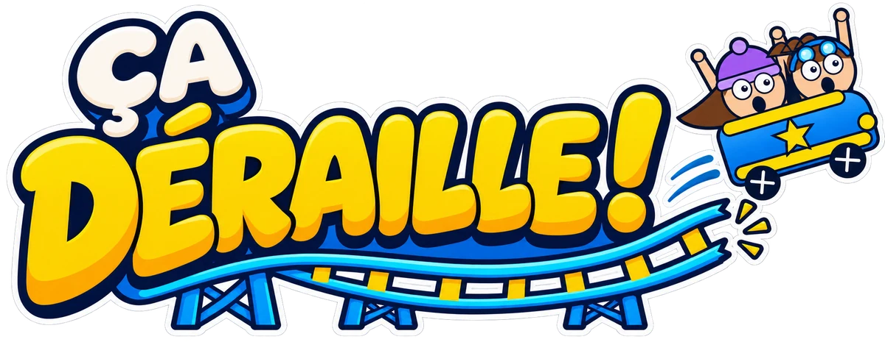

<strong>Construis, teste… et accroche-toi !</strong>

Un jeu de montagnes russes pour les 7 à 10 ans. On bâtit sa montagne russe pièce par pièce, on tire le wagon comme un lance-pierre, puis on regarde s'il se rend à la gare d'arrivée… ou s'il déraille.

Le jeu se joue sur ordinateur (souris, clavier) et sur téléphone (tactile). Il tient dans une seule page HTML, sans installation ni compte.

## Jouer

Ouvrir `index.html` dans un navigateur, ou publier le dépôt avec GitHub Pages (Settings → Pages → branche `main`, dossier `/`).

## Ce qu'on peut faire

- **Accueil** : cinq montagnes russes toutes prêtes (Le P'tit Train, Le Grand Looping, Le Grand Plouf, La Machine Folle, Le Défi Extrême) ou « Construire la tienne » à partir de la gare de départ.
- **Construire** : une bande « Mon circuit » montre les pièces dans l'ordre, avec un **+** pour choisir où ajouter et un **×** pour retirer. On touche une pièce de l'inventaire pour l'ajouter. À l'ordi, on peut aussi la glisser sur le circuit.
- **Pièces** : rails, montées et descentes, bosse, creux, chaîne, Méga chaîne et Méga descente (jusqu'à 90 m, dans les nuages), looping, tremplin, turbo, gare d'arrivée.
- **Bassin** : le rail plonge de 3 m dans l'eau. S'il passe sous le sol, le jeu creuse un trou. Le wagon ralentit dans l'eau et fait un SPLASH (MÉGA SPLASH au-dessus de 40 km/h). Un wagon qui tombe dans un bassin en volant plonge, ralentit et retombe sur le rail.
- **Machines** : catapulte, ascenseur, fusée (compte à rebours de 5 secondes, puis BOUM et feux d'artifice), canon.
- **Canon** : on choisit l'angle de tir (30°, 45°, 60° ou 75°) en l'ajoutant, et on peut le changer en touchant sa carte dans « Mon circuit ». Le wagon entre à l'horizontale, le canon pivote, puis BOUM. En construction, des pointillés montrent où le wagon va tomber : ✓ vert s'il retombe sur un rail, ✗ rouge sinon.
- **Essayer** : on tire le wagon vers l'arrière et on lâche. Bannières (« SUPER VITE! », « LOOPING! »), lignes de vitesse, ralenti pendant les sauts, et une pierre tombale avec deux petits fantômes si ça plante.
- **Enregistrer** : on donne un nom à sa montagne. Elle apparaît ensuite à l'accueil. Les montagnes sont gardées dans le navigateur de l'appareil (`localStorage`).

Raccourcis à l'ordi en construction : flèches pour déplacer le +, Retour arrière pour retirer la pièce avant le +, Ctrl+Z pour annuler.

## Organisation du code

Tout est dans `index.html` :

| Partie | Rôle |
|---|---|
| `<style>` | Interface : accueil, barres, panneaux, cartes, boutons |
| `// CORE START` … `// CORE END` | Moteur : définition des pièces, géométrie du rail, physique du wagon, montagnes prêtes (`PRESETS`) |
| Reste du `<script>` | Sons (Web Audio), construction, lance-pierre, effets, dessin du décor et des personnages (Canvas) |

Le moteur ne dépend pas de l'affichage : on peut l'extraire et le tester avec Node, par exemple pour vérifier qu'une montagne prête se rend bien à l'arrivée.

Les seules ressources externes sont les polices Google Fonts (Luckiest Guy et Fredoka), avec une police système en secours.

## Fichiers

- `index.html` : le jeu
- `assets/logo.webp`, `assets/logo-small.webp`, `assets/logo.png` : le logo
- `assets/icons/` : icône du jeu (favicon, écran d'accueil iPhone et Android)
- `manifest.webmanifest` : pour ajouter le jeu à l'écran d'accueil du téléphone
